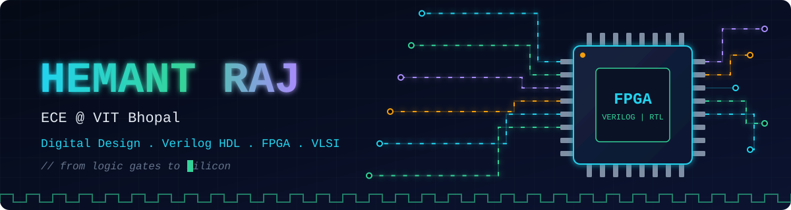
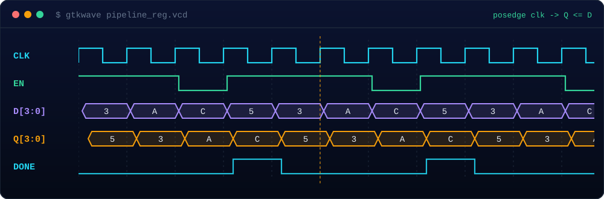

<p align="center">
  
</p>

<p align="center">
  
</p>

<p align="center">
  <a href="https://www.linkedin.com/in/hemant-raj-b54438380"></a>
  <a href="mailto:hemantraj1101@gmail.com"></a>
</p>

---

## `module hemant_raj`

```verilog
module hemant_raj (
    input  wire       clk,
    input  wire       coffee,
    input  wire       curiosity,
    output reg  [7:0] skills,
    output wire       ready_for_vlsi
);
    // learning happens on every rising edge
    always @(posedge clk) begin
        if (coffee & curiosity)
            skills <= skills + 1;
    end

    assign ready_for_vlsi = (skills == 8'hFF);   // still loading... 🔍
endmodule
```

---

## `$ whoami`

```bash
$ whoami
hemant-raj-1101

$ cat about.txt
name       : Hemant Raj
degree     : B.Tech, Electronics and Communication Engineering (ECE)
college    : Vellore Institute of Technology, Bhopal
focus      : Digital Design | Verilog HDL | FPGA | VLSI | Embedded Systems
status     : learning, building, breaking, repeating

$ ls ~/projects
script-fighter/   # AI-powered cinematic script generation tool
```

---

## 🔭 Currently Working On

- ⚡ Embedded Systems
- 🔢 Digital Fundamentals
- 💻 C/C++
- 🔬 Exploring **VLSI Design & Semiconductor Technology**
- 🤖 Building **Script Fighter**, an AI-powered cinematic script generation tool

## 🌱 Currently Learning

📚 Digital Electronics & Logic Design &nbsp;•&nbsp; 💻 C Programming &nbsp;•&nbsp; 🔠 Verilog HDL &nbsp;•&nbsp; 🔬 CMOS Fundamentals &nbsp;•&nbsp; ⚡ Embedded Systems &nbsp;•&nbsp; 📊 MATLAB &nbsp;•&nbsp; 📡 Digital Signal Processing (DSP)

Exploring **Xilinx Vivado** and practicing HDL problems on [HDLBits](https://hdlbits.01xz.net/wiki/Main_Page).

## 👯 Looking to Collaborate On

🤝 Digital Electronics &nbsp;•&nbsp; 🔌 Embedded Systems &nbsp;•&nbsp; 🧩 FPGA Projects &nbsp;•&nbsp; 🖥️ Verilog HDL &nbsp;•&nbsp; 🔬 VLSI &nbsp;•&nbsp; innovative hardware + AI solutions

## 🤝 Looking for Help With

🧠 Strengthening Digital Logic fundamentals &nbsp;•&nbsp; ⚙️ RTL Design & Verification &nbsp;•&nbsp; 🔬 CMOS inverters and transistor-level concepts &nbsp;•&nbsp; 🎯 VLSI/RTL interview preparation

## 💬 Ask Me About

🔌 ESP32 & Microcontrollers &nbsp;•&nbsp; 🔢 Digital Logic &nbsp;•&nbsp; 💻 C/C++ &nbsp;•&nbsp; 📊 MATLAB &nbsp;•&nbsp; 🐧 Fedora Linux &nbsp;•&nbsp; 📡 Signal Processing &nbsp;•&nbsp; ⚙️ Hardware–Software Integration

---

## 📌 Pinout

<p align="center">
  
</p>

## 📈 Timing Diagram

<p align="center">
  
</p>

---

## ⚡ Fun Fact

🔍 Fascinated by how simple logic gates and CMOS transistors scale into complex processors, FPGAs, and VLSI chips.
🚀 Exploring the journey from digital fundamentals to silicon.

## 🐍 Contribution Snake

<p align="center">
  <picture>
    <source media="(prefers-color-scheme: dark)" srcset="https://raw.githubusercontent.com/Hemant-Raj-1101/Hemant-Raj-1101/output/github-snake-dark.svg"/>
    <source media="(prefers-color-scheme: light)" srcset="https://raw.githubusercontent.com/Hemant-Raj-1101/Hemant-Raj-1101/output/github-snake.svg"/>
    
  </picture>
</p>

<!--
Optional, add later once your GitHub has more activity:
<p align="center">
  
</p>
-->

---

<p align="center">
  <b>// Think in gates, not in loops.</b>
</p>

<p align="center">
  Still exploring 🔍<br/>
  Still experimenting 🛠️<br/>
  Still improving 📈
</p>
